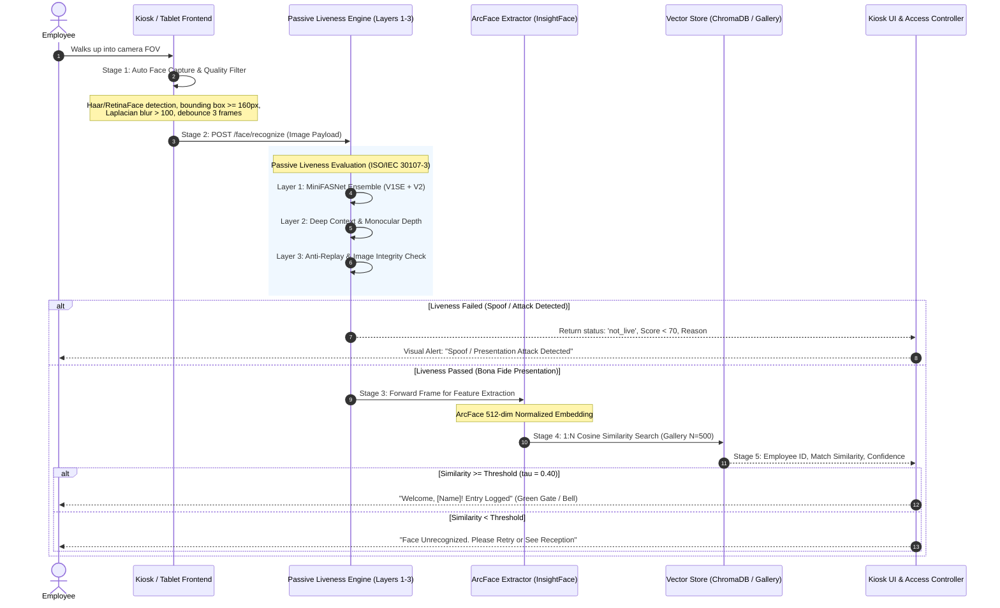

# FaceDeep On-Premise Prototype: Acceptance Criteria & Specification

**Document Version:** 1.0.0  
**Status:** Approved Baseline  
**Target Branch:** `docs/prototype-acceptance`  
**Target System:** FaceDeep On-Premise Edge & Kiosk Prototype  

---

## 1. Executive Summary & Purpose

The objective of this document is to establish unambiguous, quantitative, and testable acceptance criteria for the **FaceDeep On-Premise Kiosk & Edge Attendance Prototype**. 

This document defines the end-to-end operational pipeline, eliminates ambiguous requirements (specifically resolving the industry-common, ungrounded claim of "99% accuracy"), defines formal biometric recognition and anti-spoofing presentation attack detection (PAD) standards, locks the latency and resource budget to guarantee a sub-2-second user experience ($p95 \le 2.0\text{s}$), and itemizes customer operational requirements and open architectural questions.

---

## 2. End-to-End Prototype Flow & Architecture

The FaceDeep on-premise attendance prototype executes as an edge-oriented, closed-loop kiosk system designed for fast, frictionless employee identification.



### 2.1 Stage Breakdown & Pipeline Constraints

1. **Stage 1: Front-Facing Tablet/Camera Capture & Edge Pre-Filtering**
   - **Sensor:** Standard RGB front-facing sensor (minimum 720p @ 30 FPS, recommended 1080p).
   - **Auto Face Capture Trigger:** Automated face presence tracking without requiring user tap.
   - **Face Framing Constraints:**
     - Face bounding box width must be $\ge 160\text{ pixels}$ (or $\ge 20\%$ of frame width).
     - Head pose: Yaw $\le \pm 25^\circ$, Pitch $\le \pm 20^\circ$, Roll $\le \pm 15^\circ$.
   - **Quality Filtering:**
     - Blur assessment: Variance of Laplacian $\ge 100$.
     - Exposure check: Mean pixel intensity between $40$ and $220$ in grayscale region of interest.
   - **Temporal Debounce:** Face presence validated across 2–3 consecutive frames before trigger dispatch to prevent motion artifacts.

2. **Stage 2: Passive Liveness Detection (Presentation Attack Detection - PAD)**
   - **Zero User Interaction:** Passive only. No cooperative gestures (no blinking, head nodding, or smile prompts).
   - **Layer 1: Texture & Multi-Scale Frequency Analysis (`MiniFASNet` Ensemble):**
     - Dual-model inference: `MiniFASNetV1SE` (crop scale $4.0$ for local skin texture/cutout edges) and `MiniFASNetV2` (crop scale $2.7$ for broader facial contour and screen bezel artifacts).
     - Combined live probability decision score.
   - **Layer 2: Monocular Depth & Structural Context:**
     - Rejects flat planar presentations (photos, standard tablet screens) via depth gradient mapping.
   - **Layer 3: Software Integrity & Anti-Replay:**
     - Cryptographic timestamp and HMAC validation preventing replay of captured payloads.
   - **Independent Gating Rule:** Liveness evaluation is completely decoupled from biometric identification. If liveness fails, execution aborts immediately; no gallery vector lookup is evaluated for authentication.

3. **Stage 3: Biometric Feature Extraction**
   - **Model:** InsightFace ArcFace (`buffalo_l` backbone).
   - **Output:** 512-dimensional vector, $L_2$-normalized ($\|v\|_2 = 1.0$).
   - **Validation:** Embedding dimensionality strictly enforced to 512 dimensions with non-zero norm.

4. **Stage 4: 1:N Identification & Gallery Vector Search**
   - **Search Protocol:** 1:N identification against enrolled enterprise employee gallery ($N = 500$ baseline, scalable to $N = 5,000$).
   - **Similarity Metric:** Cosine similarity $S_c(u, v) = u \cdot v$ for $L_2$-normalized vectors, bounded in $[0, 1.0]$ for faces.
   - **Threshold Decision Gate:** Best match candidate selected via top-1 nearest neighbor. Candidate accepted if $S_c \ge \tau$ (calibrated operating point $\tau = 0.40$).

5. **Stage 5: Access Resolution & Visual Feedback**
   - **Outcomes:**
     - `SUCCESS_VERIFIED`: Bona fide live face AND top-1 similarity $\ge \tau$. Display employee profile, log attendance record, trigger relay.
     - `UNRECOGNIZED`: Bona fide live face AND top-1 similarity $< \tau$. Display "Unrecognized", prompt retry or front desk verification.
     - `SPOOF_REJECTED`: Liveness score $< 70$. Display neutral "Verification failed. Please present your natural face." Log security audit event.
     - `QUALITY_REJECT`: Poor illumination, occlusion, or severe blur. Display instructional guidance: "Center your face in good light".

---

## 3. Recognition Metrics & Deconstruction of "99% Accuracy"

### 3.1 Resolving the "99% Accuracy" Fallacy

Marketing claims such as *"99% accuracy"* are technically undefined in biometric engineering. An accuracy statement without defining:
1. Operational paradigm (1:1 Verification vs 1:N Identification),
2. Error trade-off distribution (TAR vs FAR),
3. Gallery size ($N$), and
4. Evaluation dataset demographic, lighting, and pose variance,
cannot be validated or audited.

**FaceDeep Mandate:** All recognition requirements are strictly specified using standardized biometric error rates in accordance with **ISO/IEC 19795-1** (Biometric Performance Testing and Reporting).

### 3.2 Formal Biometric Definitions

| Metric | Full Name | Formal Mathematical Definition | Operational Meaning |
|---|---|---|---|
| **TAR** | True Accept Rate | $\text{TAR}(\tau) = \frac{|\{S(x_i, y_i) \ge \tau \mid x_i, y_i \text{ same person}\}|}{|\text{Total Genuine Pairs}|}$ | Proportion of authorized employees correctly identified. |
| **FAR** | False Accept Rate | $\text{FAR}(\tau) = \frac{|\{S(x_i, y_j) \ge \tau \mid i \ne j\}|}{|\text{Total Impostor Pairs}|}$ | Proportion of unauthorized persons falsely accepted as an employee. |
| **FRR** | False Reject Rate | $\text{FRR}(\tau) = 1 - \text{TAR}(\tau)$ | Proportion of authorized employees incorrectly rejected. |
| **Rank-1 Accuracy** | Top-1 Identification Accuracy | $\text{Rank-1} = \frac{|\{\text{probe } p_i \mid \text{top-1 match is correct identity and } S \ge \tau\}|}{|\text{Total Probes}|}$ | In a closed-set gallery of size $N$, probe returns correct employee as the top-1 result. |
| **FPIR** | False Positive Identification Rate | $\text{FPIR}(\tau) = \frac{|\{\text{probe } p_u \notin \text{Gallery} \mid \max_{g \in \text{Gallery}} S(p_u, g) \ge \tau\}|}{|\text{Unenrolled Probes}|}$ | An unenrolled stranger is falsely identified as an enrolled employee. |
| **FNIR** | False Negative Identification Rate | $\text{FNIR}(\tau) = 1 - \text{Rank-1 Identification Rate}$ | An enrolled employee fails to be identified at rank 1 above threshold. |

### 3.3 Threshold Policy & Calibrated Operating Points

FaceDeep ArcFace (`buffalo_l`) generates 512-dimensional unit vectors. For genuine matches, cosine similarity values typically range from $0.45$ to $0.85$. For impostor pairs, values typically remain below $0.25$.

```
           Impostor Distribution          Genuine Distribution
                 (Different)                    (Same Person)
             ┌───────────────┐               ┌───────────────┐
             │               │               │               │
  ───────────┴───────────────┴───────┬───────┴───────────────┴───────────► Cosine Similarity
  0.0       0.15            0.30     │     0.50             0.75     1.0
                                     │
                             Operating Threshold
                              τ = 0.40 (Standard)
                              τ = 0.50 (High Security)
```

#### Required Operating Points for Prototype

1. **Standard Enterprise Mode (Default):**
   - **Threshold:** $\tau = 0.40$
   - **Target Metric:** $\text{TAR} \ge 99.0\%$ at $\text{FAR} \le 0.1\%$ ($10^{-3}$) on benchmark dataset.
   - **Rank-1 Closed-Set Accuracy:** $\ge 99.0\%$ on a gallery of $N = 500$ subjects (minimum 1 ISO/IEC 19794-5 compliant enrollment reference per subject).
   - **FRR Target:** $\le 1.0\%$ (fewer than 1 in 100 valid employee attempts require a second presentation).

2. **High Security Mode (Configurable):**
   - **Threshold:** $\tau = 0.50$
   - **Target Metric:** $\text{TAR} \ge 98.0\%$ at $\text{FAR} \le 0.01\%$ ($10^{-4}$).
   - **Use Case:** Server rooms, executive suites, critical infrastructure checkpoints.

---

## 4. Passive Liveness Metrics & Presentation Attack Detection (PAD)

### 4.1 ISO/IEC 30107-3 Standardized Metrics

Passive liveness evaluation is measured and reported strictly independently of biometric recognition accuracy.

| Metric | Definition | Mathematical Formula | Prototype Target |
|---|---|---|---|
| **APCER** | Attack Presentation Classification Error Rate | $\text{APCER}_i = \frac{|\text{PA presentations of species } i \text{ classified as live}|}{|\text{Total PA presentations of species } i|}$ | $\le 1.0\%$ for Level 1 & Level 2 |
| **BPCER** | Bona Fide Presentation Classification Error Rate | $\text{BPCER} = \frac{|\text{Bona fide live presentations classified as spoof}|}{|\text{Total Bona Fide live presentations}|}$ | $\le 2.0\%$ (Target $\le 1.0\%$) |
| **ACER** | Average Classification Error Rate | $\text{ACER} = \frac{\max_i(\text{APCER}_i) + \text{BPCER}}{2}$ | $\le 1.5\%$ |

### 4.2 Presentation Attack Instrument (PAI) Classification & Test Categories

The prototype must be validated against the following standardized attack species:

```
Presentation Attack Categories
├── Level 1: 2D Printed Photo Attacks
│   ├── Species 1.1: Matte 80-100 gsm color printout (standard office paper)
│   ├── Species 1.2: High-gloss photo paper (250+ gsm, dye-sub/inkjet)
│   └── Species 1.3: Cutout photo attack (printed photo with eye/mouth holes)
├── Level 2: 2D Digital Display / Screen Replay Attacks
│   ├── Species 2.1: iPad / Tablet 10-12" high-resolution LCD display (264+ PPI)
│   ├── Species 2.2: Smartphone OLED display (450+ PPI, high dynamic range)
│   └── Species 2.3: Laptop 15" IPS monitor video playback (moving live selfie replay)
└── Level 3: 3D / Structured Physical Attacks
    ├── Species 3.1: 3D curved paper / cardboard contoured mask
    └── Species 3.2: Commercial latex/silicone realistic mask (Exploratory / Day 4)
```

### 4.3 Independent Reporting & Gating Rule

1. **Separation of Metrics:** The test report MUST produce two completely distinct scorecards:
   - *Scorecard A: Biometric Recognition Performance (TAR, FAR, Rank-1)*
   - *Scorecard B: Presentation Attack Detection (APCER per species, BPCER)*
2. **Sequential Gate:** A transaction is considered an authorized passage IF AND ONLY IF:
   $$\text{LivenessScore} \ge 70.0 \quad \text{AND} \quad \text{CosineSimilarity} \ge 0.40$$
   A presentation attack that achieves high facial similarity with an enrolled user must register as a successful rejection due to PAD ($\text{APCER}$ violation), not an authorization.

---

## 5. Performance, Latency & Edge Resource Budgets

### 5.1 End-to-End Latency Budget ($p95 \le 2.0\text{s}$)

The end-to-end latency ($T_{\text{e2e}}$) is defined as the elapsed time from when the edge camera captures a valid face frame to when the employee result (Name, Verification Status, Relay Signal) is rendered on the kiosk UI:

$$T_{\text{e2e}} = T_{\text{capture\_prep}} + T_{\text{network\_transit}} + T_{\text{liveness}} + T_{\text{embedding}} + T_{\text{search}} + T_{\text{render}}$$

| Pipeline Stage | Subsystem / Operation | Typical ($p50$) | Maximum Allowed ($p95$) | Worst Case ($p99$) |
|---|---|---|---|---|
| **Stage 1** | Frame Capture, ROI Crop & Format Validation | $40\text{ ms}$ | $100\text{ ms}$ | $150\text{ ms}$ |
| **Network** | Edge Tablet $\to$ On-Prem Local Server (LAN/Wi-Fi) | $20\text{ ms}$ | $50\text{ ms}$ | $100\text{ ms}$ |
| **Stage 2** | Passive Liveness Inference (MiniFASNet Ensemble + Depth) | $180\text{ ms}$ | $350\text{ ms}$ | $450\text{ ms}$ |
| **Stage 3** | ArcFace Feature Extraction (512-dim embedding) | $220\text{ ms}$ | $450\text{ ms}$ | $600\text{ ms}$ |
| **Stage 4** | Vector Search in Gallery ($N = 500$ to $5,000$) | $10\text{ ms}$ | $40\text{ ms}$ | $70\text{ ms}$ |
| **Stage 5** | Response Serialization & UI Rendering | $30\text{ ms}$ | $60\text{ ms}$ | $100\text{ ms}$ |
| **Total End-to-End** | **User Walk-up to Feedback Display** | **$\mathbf{\approx 500\text{ ms}}$** | **$\mathbf{\le 1050\text{ ms}}$** | **$\mathbf{\le 1470\text{ ms}}$** |

> **Guaranteed Hard Limit:** Under all specified operational conditions on baseline on-premise hardware, $T_{\text{e2e}}$ must satisfy:
> $$\mathbf{p95 \le 2000\text{ ms} \quad (2.0\text{ seconds})}$$

### 5.2 Throughput & Concurrency Specifications

- **Single Kiosk Walk-up Throughput:** $\ge 15$ completions per minute per kiosk in continuous single-file foot traffic (maximum 4.0 seconds total transaction cycle including human walk-up).
- **On-Premise Server Capacity:** $\ge 50$ requests per second concurrent throughput on a standard 8-core on-prem server instance.

### 5.3 Hardware Resource Envelope (On-Premise Edge Appliance)

The prototype must operate efficiently within constrained enterprise edge hardware (e.g., mini-PC appliance, Intel NUC, or industrial edge box):

| Resource | Baseline Target | Hard Upper Limit | Test Measurement Condition |
|---|---|---|---|
| **CPU Architecture** | x86_64 or ARM64 (e.g. Jetson Orin) | 4 vCPU cores | Continuous 1 req/sec stream |
| **CPU Utilization** | $\le 45\%$ average | $\le 70\%$ peak | Measured via `psutil` over 5 min run |
| **RAM Footprint (RSS)**| $\le 2.2\text{ GB}$ | $\le 3.5\text{ GB}$ | Including Python runtime, ONNX, and models |
| **Disk Storage** | $\le 2.5\text{ GB}$ | $\le 5.0\text{ GB}$ | Models, container images, dependencies |
| **GPU/NPU (Optional)**| Optional (CPU Execution Provider) | Native CPU supported | CPU execution must meet $p95 \le 2.0\text{s}$ |

### 5.4 Model Warm-Up & Cold-Start Policy

- **The Problem:** The initial inference execution in ONNX Runtime / InsightFace incurs memory allocation, execution provider graph optimizations, and dynamic library linking overhead, resulting in an unacceptably slow first request ($> 5.0\text{s}$).
- **Prototype Acceptance Requirement:**
  1. An explicit initialization routine must run during service boot prior to declaring the health check `/ready`.
  2. The warm-up routine must execute one complete forward pass of a synthetic $640 \times 640$ blank image through:
     - `FaceAnalysis` (detection + ArcFace feature extraction)
     - `Layer1TextureAnalysis` (`MiniFASNetV1SE` and `MiniFASNetV2`)
     - `Layer2DeepContext` (depth session)
  3. Employee #1 must experience standard $p95 \le 2.0\text{s}$ response latency without cold-start penalties.

---

## 6. Measurable Pass/Fail Acceptance Matrix

| Req ID | Evaluation Area | Metric | Dataset / Test Condition | Pass Threshold | Target Threshold | Verification Protocol |
|---|---|---|---|---|---|---|
| **REQ-REC-01** | Biometric Match | TAR @ FAR = 0.1% | 500 genuine probe pairs | $\ge 98.0\%$ | $\ge 99.0\%$ | Automated evaluation script |
| **REQ-REC-02** | Gallery Match | Rank-1 Closed-Set | Gallery $N=500$, 1 ISO ref/person | $\ge 98.5\%$ | $\ge 99.2\%$ | 1:N probe benchmark harness |
| **REQ-REC-03** | Impostor Rejection | FAR @ $\tau = 0.40$ | 10,000 impostor cross-pairs | $\le 0.1\%$ | $\le 0.05\%$ | Cross-identity pair matrix |
| **REQ-PAD-01** | Print Spoof Detection| APCER (Level 1) | 50 print PAI presentations (matte/gloss) | $\le 2.0\%$ | $\le 0.5\%$ | Presentation attack test battery |
| **REQ-PAD-02** | Screen Replay PAD | APCER (Level 2) | 50 screen replays (tablet/OLED) | $\le 2.0\%$ | $\le 0.5\%$ | Video & photo replay battery |
| **REQ-PAD-03** | Live False Rejection | BPCER | 200 bona fide live presentations | $\le 2.0\%$ | $\le 1.0\%$ | Natural live probe test set |
| **REQ-PERF-01**| End-to-End Latency | $p95$ Latency | 500 consecutive test runs (LAN) | $\le 2000\text{ ms}$ | $\le 1050\text{ ms}$ | High-precision benchmark timer |
| **REQ-PERF-02**| Typical Latency | $p50$ Latency | 500 consecutive test runs (LAN) | $\le 1000\text{ ms}$ | $\le 600\text{ ms}$ | High-precision benchmark timer |
| **REQ-PERF-03**| Edge CPU Usage | Average CPU % | 4-core host @ 1 req/sec load | $\le 70\%$ | $\le 45\%$ | Continuous `psutil` sampling |
| **REQ-PERF-04**| Edge Memory RSS | Peak RAM (MB) | Resident memory during peak test | $\le 3500\text{ MB}$ | $\le 2200\text{ MB}$ | OS process RSS inspection |
| **REQ-BOOT-01**| Cold-Start Elimination| 1st Request Latency | First user request after boot | $\le 2000\text{ ms}$ | $\le 1200\text{ ms}$ | Automated boot-probe test |

---

## 7. Assumptions & Customer Open Questions

### 7.1 Technical Assumptions
1. **Enrollment Photo Quality:** Enrollment images in the enterprise database satisfy baseline passport/ID standard (front-facing, $\ge 300\text{px}$ inter-pupillary distance, neutral expression, uniform illumination).
2. **Kiosk Environment:** The kiosk tablet or camera is deployed in a standard indoor corporate lobby or access turnstile where ambient illuminance is controlled between $150\text{ lux}$ and $1000\text{ lux}$ (no direct backlight glare from sunlight).
3. **On-Premise Connectivity:** Network communication between the front tablet and the on-premise edge backend occurs across a dedicated local Wi-Fi or wired Ethernet LAN (latency $\le 20\text{ ms}$).
4. **Hardware Acceleration:** While GPU (CUDA/TensorRT) is supported, CPU inference on modern multi-core x86/ARM hardware is the baseline standard for deployment cost efficiency.

### 7.2 Customer Open Questions (Action Required)

To finalize the production rollout parameters beyond this prototype, the following customer-specific questions must be resolved:

1. **Physical Kiosk Hardware & Mounting:**
   - *Question:* What exact tablet or industrial kiosk hardware is planned for production (e.g., iPad 10th Gen, Samsung Galaxy Tab Active, Elo Touch I-Series, or dedicated industrial camera + Linux SBC)?
   - *Impact:* Determines camera sensor color fidelity, lens distortion, and whether edge inference can run on-device or must stream to an edge box.

2. **Enrollment Base & Gallery Scale:**
   - *Question:* What is the expected initial and maximum employee count at each facility ($N = 500$, $N = 2,000$, or $N = 50,000$)?
   - *Question:* Does the customer already have a centralized directory (e.g., HRIS, Workday, Microsoft Entra ID) with existing badge photos, or will an enrollment kiosk app be required?
   - *Impact:* Dictates vector index structure (flat index vs HNSW/IVF in ChromaDB).

3. **Lighting & Environmental Extremes:**
   - *Question:* Are any kiosks positioned near glass facades, revolving doors, or outdoor gates where direct solar exposure or severe backlighting occurs?
   - *Impact:* In severe backlighting, auxiliary fill-light / IR LED ring illumination is required for passive liveness and accurate feature extraction.

4. **Access Control Integration Interface:**
   - *Question:* How should FaceDeep signal physical access grant/denial (e.g., Wiegand protocol over USB/RS485 converter, dry contact relay over GPIO, OSDP v2, or webhook to turnstile controller)?
   - *Impact:* Defines required hardware I/O modules and physical relay controller drivers.

5. **Compliance & Privacy Policy (Air-Gapped vs Sync):**
   - *Question:* Does customer data privacy policy permit biometric template synchronization across multi-building sites, or must each building remain strictly air-gapped?
   - *Question:* What is the customer's raw image retention requirement (e.g., zero storage of probe images; store only embeddings; or audit log with 30-day auto-purge)?
   - *Impact:* Informs database retention jobs, encryption-at-rest keys, and audit logging parameters.
